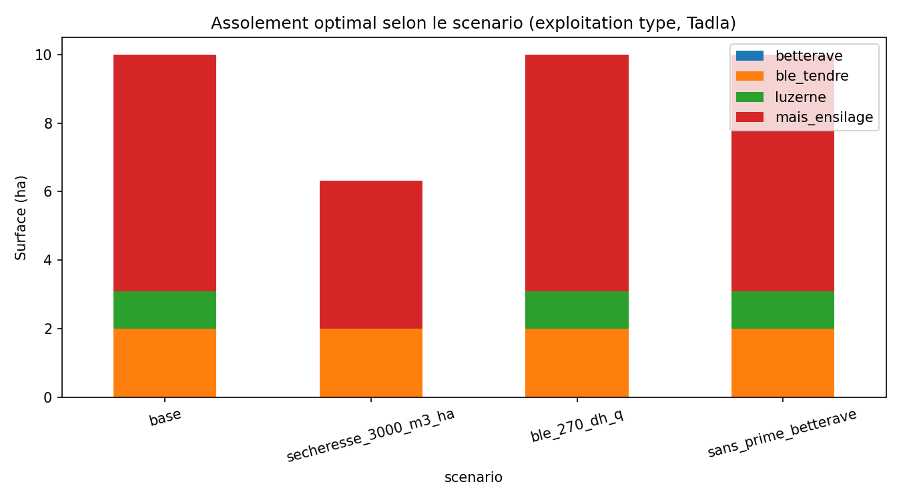
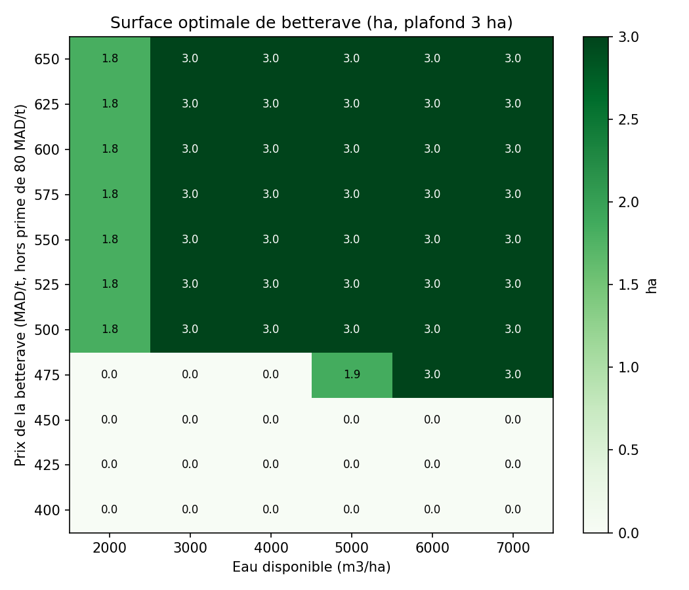

# Optimisation de l'assolement d'une exploitation irriguée du Tadla (Maroc)

Modèle de programmation linéaire (Python, PuLP) qui détermine l'assolement maximisant la
marge brute d'une exploitation type de 10 ha dans le périmètre irrigué du Tadla (ORMVAT),
puis teste des scénarios de sécheresse, de prix et de politique agricole.

> **Statut : version 0.1, données partiellement sourcées.**
> Chaque paramètre de `data/parametres.csv` porte sa source, son année et un statut de qualité.
> Les résultats ne doivent pas être interprétés tant que les paramètres `hypothese` et
> `ancien` n'ont pas été remplacés (voir « Qualité des données »).

## Problème
Face à la baisse de la dotation en eau d'irrigation, comment une exploitation de 10 ha du
Tadla doit-elle adapter son assolement, et quelle est la valeur économique d'un m³ d'eau
supplémentaire ?

## Modèle
- **Variables :** surface x_c (ha) de chaque culture c.
- **Objectif :** maximiser Σ MB_c · x_c, avec MB_c = rendement × (prix + prime de l'État) − charges.
- **Contraintes :** surface ≤ 10 ha ; eau ≤ volume disponible ; betterave ≤ plafond de rotation ;
  céréales ≥ 20 % de la surface (hypothèse).
- **Cultures :** blé tendre, betterave à sucre, luzerne, maïs ensilage.

## Qualité des données
Statuts : `source` (valeur lue dans la source), `derive` (calcul à partir de sources),
`ancien` (sourcé mais daté de 2005-2007, à actualiser), `hypothese` (à valider).

| Culture | Paramètre | Statut | Origine |
|---|---|---|---|
| Blé tendre | prix 2 800 MAD/t | source | ONICL, prix référentiel 2026 (280 DH/q) |
| Blé tendre | rendement 5,2 t/ha, eau 4 536 m³/ha | source | FAO 2017 (présentation ORMVA) |
| Blé tendre | charges | **hypothèse** | à remplacer (fiche technico-économique ORMVAT) |
| Betterave | rendement 58,7 t/ha | dérivé | Cosumar 2024/25 : 2 005 380 t / 34 150 ha |
| Betterave | prime de l'État 80 DH/t | source | FIMASUCRE, décembre 2023 |
| Betterave | prix, charges, eau | **hypothèse** | à remplacer (Cosumar, ORMVAT) |
| Luzerne, maïs | rendements, charges, eau | **ancien** | Sraïri et Kuper (2007), Tadla 2005/06 |
| Luzerne, maïs | prix | dérivé | valeur de remplacement en UFL (2007) |
| Ressources | surface 10 ha, eau 60 000 m³ | **hypothèse** | exploitation type |
| Scénario | dotation de sécheresse 3 000 m³/ha | source | Médias24 |
| Scénario | blé à 270 DH/q | source | prix de référence ONICL 2024/25 |

**Limite majeure :** les cultures fourragères reposent sur des données de 2005-2007 alors que
le blé est à des prix de 2026. Les marges ne sont donc pas comparables tant que ces données
ne sont pas actualisées.

## Utilisation
```bash
pip install -r requirements.txt
python src/modele.py
```
Le script affiche un rapport de qualité des données, écrit `results/scenarios.csv` et
`results/sensibilite_betterave.csv`, et trace `results/assolement.png` et
`results/sensibilite_betterave.png`.

## Résultats
> **Résultats préliminaires (v0.1).** Ils reposent sur des paramètres encore provisoires
> (statuts `hypothese` et `ancien`, voir « Qualité des données »). Ils montrent le
> fonctionnement du modèle et les mécanismes économiques en jeu ; ils ne constituent pas
> une conclusion sur l'agriculture du Tadla.

Exploitation type de 10 ha. Surfaces en hectares.

| Scénario | Marge brute (MAD) | Blé tendre | Luzerne | Maïs ensilage | Betterave | Jachère | Valeur du m³ d'eau (MAD) |
|---|---|---|---|---|---|---|---|
| Base (60 000 m³) | 98 756 | 2,0 | 1,1 | 6,9 | 0 | 0 | 0,10 |
| Sécheresse (3 000 m³/ha) | 60 011 | 2,0 | 0 | 4,3 | 0 | 3,7 | 2,10 |
| Blé à 270 DH/q | 97 716 | 2,0 | 1,1 | 6,9 | 0 | 0 | 0,10 |
| Sans prime betterave | 98 756 | 2,0 | 1,1 | 6,9 | 0 | 0 | 0,10 |

- **Base :** la marge est de 98 756 MAD, soit environ 9 880 MAD/ha. La terre et l'eau sont
  toutes deux limitantes.
- **Sécheresse :** avec 50 % d'eau en moins, la marge baisse de 39 % (− 38 745 MAD). La luzerne
  disparaît, le maïs passe de 6,9 à 4,3 ha et 3,7 ha restent en jachère.
- **Blé à 270 DH/q :** la marge baisse de 1 040 MAD (− 1,1 %), sans changement d'assolement.
- **Sans prime de l'État :** aucun changement, car la betterave n'entre pas dans l'assolement optimal.



## Interprétation économique

**1. La marge par hectare et la marge par m³ d'eau classent les cultures différemment.**
La luzerne a la meilleure marge par hectare (11 319 MAD) mais la plus faible par m³ (0,71 MAD),
car elle consomme 15 860 m³/ha. Le maïs ensilage est le plus productif par m³ (2,10 MAD),
devant le blé (1,78) et la betterave (1,69). Quand la terre est rare, la luzerne est retenue ;
quand l'eau devient rare, elle est la première abandonnée.

**2. La valeur de l'eau dépend du régime de rareté.**
En année normale, un m³ supplémentaire vaut 0,10 MAD, car la terre est aussi limitante
(un hectare supplémentaire vaudrait 9 666 MAD). En sécheresse, la terre cesse d'être limitante
et un m³ vaut 2,10 MAD, soit environ 20 fois plus : c'est la marge par m³ du maïs, culture
marginale. Ce prix dual est une valeur marginale, valable pour de petites variations autour de
l'optimum. Il reste à le comparer au tarif de l'eau d'irrigation, que le dépôt ne documente pas
encore.

**3. S'adapter par substitution entre cultures limite la perte.**
Face à une baisse de 50 % de l'eau, la marge diminue de 39 %. Une réduction uniforme de 50 % de
toutes les surfaces la ferait baisser de 50 % (49 378 MAD) : réallouer l'eau vers les cultures les
plus productives par m³ préserve environ 10 600 MAD de marge (+ 22 %).

**4. La contrainte de 20 % de céréales a un coût d'opportunité.**
Le blé a la plus faible marge par hectare (8 060 MAD) et se situe sous le maïs par m³ ; il n'est
cultivé que parce que la contrainte l'impose. Elle coûte 4 158 MAD en année normale (4,2 % de la
marge) et 2 906 MAD en sécheresse. Cela explique pourquoi une baisse du prix du blé de 280 à
270 DH/q réduit la marge sans modifier l'assolement. C'est un ordre de grandeur du coût, pour
l'exploitation, d'une préférence pour la sécurité alimentaire ou la rotation.

**5. La betterave est à la limite de la rentabilité, et ce résultat est fragile.**
Sa marge est de 10 111 MAD/ha avec la prime de l'État, contre 5 415 sans elle : la prime
(80 DH/t, soit 4 696 MAD/ha) représente près de la moitié de la marge. La betterave est à 61 MAD/ha
du maïs ; elle le rattraperait à un prix effectif de 531 MAD/t et dépasserait la luzerne à environ
551 MAD/t, contre 530 dans l'hypothèse actuelle. L'absence de betterave dépend donc de deux
paramètres non vérifiés (prix de 450 MAD/t, charges de 21 000 MAD/ha) et ne doit pas être lue
comme un résultat.

**6. Limites de la lecture.**
- Les données fourragères datent de 2005-2007 et le blé est à des prix de 2026 : les marges ne
  sont pas strictement comparables.
- La luzerne et le maïs sont valorisés au coût de remplacement, pas à un prix de marché.
- La main-d'œuvre n'est pas modélisée, alors que la betterave en demande beaucoup.
- Le modèle est statique, sans risque ni variabilité des prix.

**Prochaines étapes :** remplacer les paramètres `hypothese` et `ancien`, intégrer la
main-d'œuvre et comparer la valeur de l'eau au tarif d'irrigation.

## Analyse de sensibilité : prix de la betterave et eau disponible

Comme le prix de la betterave est une hypothèse, j'ai testé 11 prix (400 à 650 MAD/t, hors
prime de 80 MAD/t) et 6 niveaux d'eau (2 000 à 7 000 m³/ha). Le modèle est relancé pour chaque
combinaison (plafond de 3 ha de betterave).



- **La décision se joue sur un intervalle étroit de prix.** La betterave n'entre jamais dans
  l'assolement à 450 MAD/t ou moins, et y entre à 475 MAD/t dès 5 000 m³/ha (3 ha à
  6 000 m³/ha). Pour des dotations de 3 000 à 4 000 m³/ha, le seuil se situe entre 475 et
  500 MAD/t. Le seuil est donc d'environ 450 à 500 MAD/t selon l'eau, soit 530 à 580 MAD/t prime
  incluse.
- **L'hypothèse actuelle est juste sous le seuil.** À 450 MAD/t, la betterave est absente ;
  à 475 MAD/t (+ 5,6 %), elle occupe 3 ha et la marge passe de 98 756 à 102 617 MAD (+ 3,9 %).
  Une variation de 25 MAD/t équivaut, par hectare, à environ 1 470 MAD de charges (7 %) : les
  charges non vérifiées jouent donc autant que le prix.
- **Quand l'eau devient rare, la betterave est plus compétitive que la luzerne.** À 3 000 m³/ha et
  500 MAD/t, elle occupe 3 ha et la marge est de 61 399 MAD, contre 60 011 sans elle (+ 2,3 %).
  À 2 000 m³/ha, l'eau limite sa surface à 1,8 ha.
- **L'effet de l'eau sur la marge est robuste.** Quel que soit le prix de la betterave, passer de
  7 000 à 3 000 m³/ha réduit fortement la marge (− 40 % à 450 MAD/t). Au-delà de 5 000 m³/ha,
  l'eau pèse peu : la marge n'augmente que de 2 % entre 5 000 et 7 000 m³/ha.

**Conclusion de l'analyse :** l'absence de betterave dans le scénario de base n'est pas robuste,
car elle dépend d'un prix et de charges à vérifier. En revanche, la forte sensibilité de la marge
à l'eau disponible en dessous de 5 000 m³/ha l'est. La donnée à obtenir en priorité est le prix
payé à l'agriculteur et les charges de la betterave.

## Limites
- Modèle statique, sans risque ni variabilité des prix ; linéarité des rendements et des charges.
- Exploitation type, non calibrée sur une exploitation réelle.
- Main-d'œuvre non modélisée faute de données sourcées.

## Sources
- ONICL / presse : prix référentiel du blé tendre, campagne 2026 (280 DH/q) ; 270 DH/q en 2024/25.
- Cosumar : bilan de la campagne sucrière 2024/25 ; FIMASUCRE : appui de 80 DH/t.
- Sraïri M.T. et Kuper M., « Valorisation de l'eau en agriculture », PNTTA bulletin n°157, 2007.
- FAO, « Productivity country experience Morocco », 2017.
- Médias24 : dotation moyenne actuelle de 3 000 m³/ha dans les périmètres irrigués.
